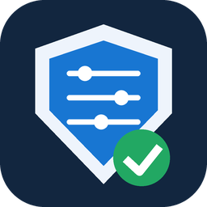
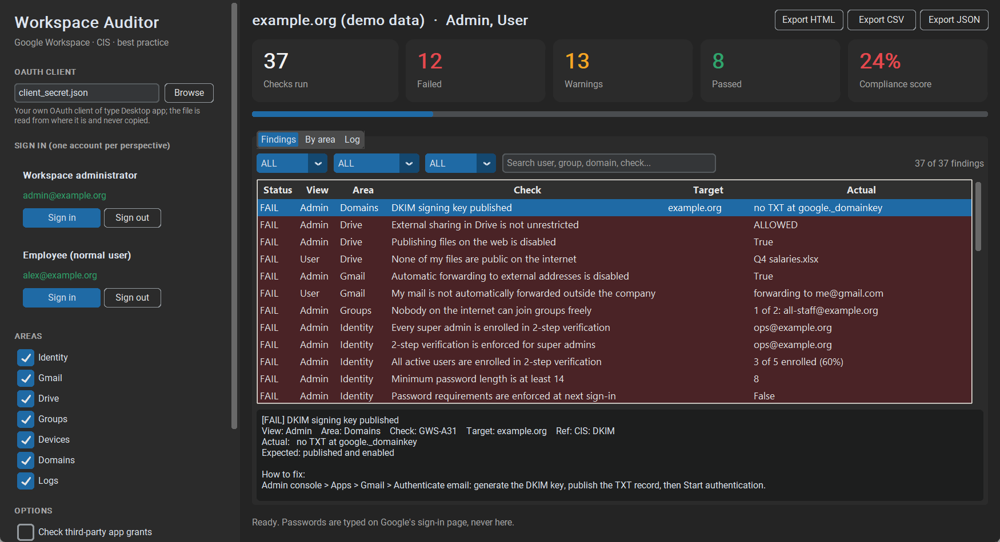
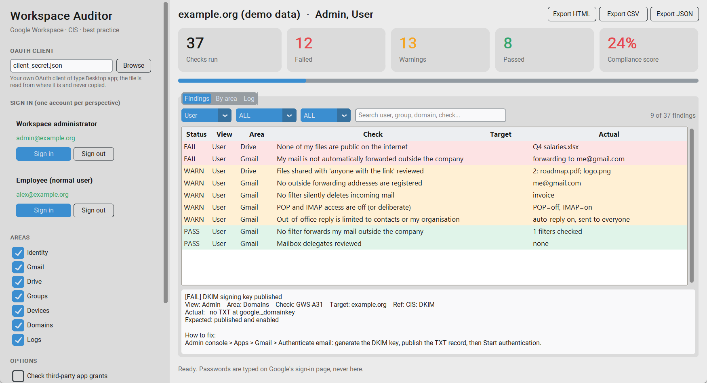

<p align="center">
  
</p>

<h1 align="center">🛡️ Google Workspace Config Auditor</h1>

<p align="center">
  <b>Audit your Google Workspace against CIS-style hardening and international best practice,<br>
  as an administrator <i>and</i> as an ordinary employee.</b><br>
  Read-only checks for 🔑 Identity, 📧 Gmail, 📁 Drive, 👥 Groups, 📱 Devices, 🌐 Email authentication and 📜 Sign-in logs, in a modern desktop GUI.
</p>

<p align="center">
  
  
  
  
  
  
</p>

<p align="center">
   
</p>
<p align="center"><sub>Screenshots use <b>made-up demo data</b> (<code>tools/make_screenshot.py</code>), not a real Workspace.</sub></p>

> 🚧 **Status:** every check is covered by offline tests against canned Google API data, but the tool has **not yet run against a live Google Workspace**. Try it first in a test Workspace and report anything that differs. The Cloud Identity **Policy API** setting names in `gws_audit/data/policies.json` are best-effort: anything unrecognised is shown as ⚪ `MANUAL` with the raw value, never as a pass.
>
> ℹ️ This is an independent tool inspired by the *CIS Google Workspace Foundations Benchmark* and common best practice. It is **not** produced, endorsed or certified by CIS or Google, and its IDs are its own (not CIS section numbers).

## 📑 Contents

[✨ Features](#-features) · [🧭 Two perspectives](#-two-perspectives) · [🚀 Quick start](#-quick-start) · [🔑 Permissions](#-permissions) · [✅ Checks reference](#-checks-reference) · [🔐 Safety](#-safety) · [🚧 Limits](#-limits) · [🧪 Tests](#-tests) · [❓ FAQ](#-faq) · [📌 Roadmap](#-roadmap) · [📄 License](#-license)

## ✨ Features

| | |
|---|---|
| 👑 **Admin view** | Workspace-wide settings and inventory through the Admin SDK and Cloud Identity APIs |
| 👤 **Employee view** | What a normal account has set up in Gmail and how its Drive files are shared |
| 🔑 **Identity** | Super admin count, 2-step verification enrolment and enforcement, dormant accounts, third-party app grants, password and session policy |
| 📧 **Gmail** | Auto-forwarding, POP/IMAP, plus (employee) forwarding rules, delete filters, delegates, out-of-office leakage |
| 📁 **Drive** | External sharing mode, sharing warnings, web publishing, plus (employee) public and link-shared files |
| 👥 **Groups** | Groups anyone can join, view or post to; external members |
| 📱 **Devices** | Compromised, unlocked, unencrypted and stale mobile devices |
| 🌐 **Email authentication** | SPF, DKIM, DMARC and MTA-STS per domain |
| 📜 **Logs** | Suspicious sign-in events in the last 7 days |
| 🖥️ **Modern GUI** | Dark / light themes, summary cards, filters, search and fix instructions; plus a CLI and HTML / CSV / JSON export |

### 🚦 Status legend

🔴 **FAIL** needs fixing · 🟠 **WARN** review · 🔵 **INFO** for awareness · ⚪ **MANUAL** check it by hand · 🟣 **ERROR** the check itself failed · 🟢 **PASS** compliant

## 🧭 Two perspectives

```
 👑 Workspace admin sign-in ──► Admin SDK + Cloud Identity ──┐
                                                              ├──►  🛡️ findings tagged Admin / User  ──►  📦 HTML · CSV · JSON
 👤 Employee sign-in        ──► their own Gmail + Drive ─────┘
```

You sign in **twice**, with two different accounts: a Workspace administrator and an ordinary employee. Each sign-in requests only the read scopes its own checks need. You can also run just one perspective. Google's sign-in page handles the password and 2-step verification: **this tool never sees a password**, and tokens stay in memory (no token file is written).

## 🚀 Quick start

### 1️⃣ Create an OAuth client (once)
1. In the Google Cloud console, create or pick a project in **your Workspace organisation**.
2. **Enable APIs:** *Admin SDK API*, *Groups Settings API*, *Cloud Identity API*, *Gmail API*, *Google Drive API*.
3. **OAuth consent screen:** choose **Internal** (only your organisation's users can sign in, and no Google verification is needed).
4. **Credentials > Create credentials > OAuth client ID > Desktop app**, then download the JSON.

### 2️⃣ Run the GUI
```powershell
pip install -r requirements.txt
python gws_audit_gui.py
```
1. **Browse** to the downloaded client JSON.
2. Click **Sign in** under 👑 *Workspace administrator* and/or 👤 *Employee*; a browser window opens on Google's sign-in page.
3. Choose the areas, then **Run audit**.
4. Use the filters to switch between **Admin** and **User** findings, **By area** for the split, and **Export** for a report.

### ⌨️ Command line
```powershell
python gws_audit_cli.py --client-secrets client_secret.json --admin --user
python gws_audit_cli.py --client-secrets client_secret.json --user --areas Gmail,Drive
python gws_audit_cli.py --client-secrets client_secret.json --admin --tokens        # also list third-party app grants
```
Writes `gws_audit.html`, `.csv` and `.json`.

## 🔑 Permissions

| | Scopes requested (only for the areas you select) |
|---|---|
| 👑 **Admin** | `admin.directory.user.readonly` · `cloud-identity.policies.readonly` · `admin.directory.group.readonly` · `apps.groups.settings` · `admin.directory.device.mobile.readonly` · `admin.directory.domain.readonly` · `admin.reports.audit.readonly` |
| 👑 **Admin (opt-in)** | `admin.directory.user.security`, only if you tick *Check third-party app grants* |
| 👤 **User** | `gmail.readonly` (Gmail area) · `drive.metadata.readonly` (Drive area) · `openid` · `userinfo.email` |

> **Be aware:** Google defines `apps.groups.settings` and `admin.directory.user.security` as read/write scopes (there is no read-only variant for those endpoints), and `gmail.readonly` as access to mail. The tool only issues **GET** requests, only to settings and metadata endpoints, and never requests message bodies or file contents; a test enforces that the client has no write methods. Use the opt-in for third-party app grants only if you accept that scope.

The administrator account needs the matching admin privileges (a super admin, or a delegated admin with user, group, device, domain and reports read roles).

## ✅ Checks reference

<details>
<summary><b>🔑 Identity</b> (admin <code>GWS-A0*</code>/<code>GWS-A1*</code>, settings <code>GWS-G0*</code>)</summary>

| ID | Check | View |
|---|---|---|
| GWS-A01 | Two to four super administrators | 👑 |
| GWS-A02 / A03 | Super admins enrolled in and enforced for 2-step verification | 👑 |
| GWS-A04 / A05 | All active users enrolled in, and organisation enforces, 2SV | 👑 |
| GWS-A06 | No accounts inactive for more than 90 days | 👑 |
| GWS-A10 / A11 | Third-party apps with broad access; app inventory (opt-in) | 👑 |
| GWS-G07 / G08 / G09 | Minimum password length 14, enforced at sign-in, web session length (Policy API) | 👑 |
</details>

<details>
<summary><b>📧 Gmail</b> (admin <code>GWS-G01..G03</code>, employee <code>GWS-U01..U07</code>)</summary>

| ID | Check | View |
|---|---|---|
| GWS-G01..G03 | Auto-forwarding, POP and IMAP disabled organisation-wide (Policy API) | 👑 |
| GWS-U01 / U02 | My mail is not forwarded outside the company; no outside forwarding addresses | 👤 |
| GWS-U03 / U04 | No filter forwards my mail outside; none silently deletes it | 👤 |
| GWS-U05 / U06 / U07 | POP/IMAP, delegates, out-of-office leakage | 👤 |
</details>

<details>
<summary><b>📁 Drive</b> (admin <code>GWS-G04..G06</code>, employee <code>GWS-U10..U11</code>)</summary>

| ID | Check | View |
|---|---|---|
| GWS-G04 / G05 / G06 | External sharing mode, sharing warning, web publishing (Policy API) | 👑 |
| GWS-U10 | None of my files are public on the internet | 👤 |
| GWS-U11 | Files shared with "anyone with the link" reviewed | 👤 |
</details>

<details>
<summary><b>👥 Groups · 📱 Devices · 🌐 Domains · 📜 Logs</b></summary>

| ID | Check | View |
|---|---|---|
| GWS-A20..A23 | Groups anyone can join / view / post to; external members | 👑 |
| GWS-A40..A43 | Compromised, unlocked, unencrypted and stale mobile devices | 👑 |
| GWS-A30..A33 | SPF, DKIM, DMARC and MTA-STS per domain | 👑 |
| GWS-A50 | No suspicious sign-ins in the last 7 days | 👑 |
</details>

Each finding also carries a `reference` naming the benchmark theme or best practice it relates to.

## 🔐 Safety

- 🔒 **Read-only:** only HTTP `GET` requests; the API client has no write methods and a test enforces it.
- 🔑 **No passwords handled or stored:** sign-in is Google's own page; tokens live in memory only; OAuth client files are ignored by `.gitignore`.
- 📏 **Bounded:** user, group and sampled-app counts are capped (see `ScanOptions`), and the employee Drive scan reads file *names and sharing state* only.
- 🗂️ **Reports are sensitive:** they list users, groups, files and weaknesses; treat exported files as confidential. Data is HTML-escaped in the HTML report.

## 🚧 Limits

- Not yet validated on a live Workspace (see the status note above).
- Policy API setting and field names may differ by edition or API version; unknown ones show as ⚪ `MANUAL`. Edit `gws_audit/data/policies.json` to adjust.
- A setting defined at several organisational units is judged by its **worst** value; per-OU precedence is not resolved.
- Many Admin-console settings are not exposed to any API (for example some Gmail safety and spoofing options) and need manual review.
- Employee-view results depend on what the signed-in account may read; denied calls show as 🟠 `WARN`.
- A focused set of checks, not a full benchmark; DKIM assumes the default `google` selector.

## 🧪 Tests

```powershell
python tests/test_checks.py
```
Runs every check against canned API data (no account or network), plus the REST client's paging and retry, scope minimisation, the policy baseline, report escaping and the GUI logic.

## ❓ FAQ

<details><summary><b>Do I need two accounts?</b></summary>
Only for both views. Sign in with just an administrator for Workspace-wide settings, or just an employee to see what a regular user has configured.
</details>

<details><summary><b>Why my own OAuth client?</b></summary>
It keeps consent under your control: an Internal consent screen limits sign-in to your organisation, and no third-party app has access to your tenant.
</details>

<details><summary><b>Can it change settings?</b></summary>
No. It only reads, and every finding explains how to fix it in the Admin console.
</details>

<details><summary><b>Why are some checks MANUAL?</b></summary>
Either the setting is not exposed by an API, or the API returned a setting or field this tool does not recognise. The raw value is shown so you can verify it.
</details>

## 📌 Roadmap

- [ ] Validate against a test Workspace and fix any API differences
- [ ] Windows executable via PyInstaller
- [ ] Resolve organisational-unit precedence for policies
- [ ] More Gmail safety and Chat/Meet checks; baseline file and per-check enable/disable

## 📄 License

[MIT](LICENSE)
